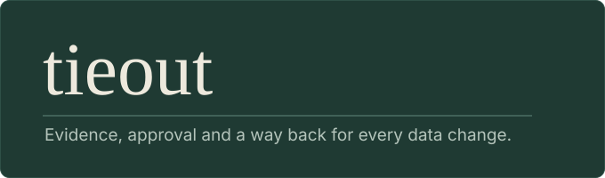

<h1 align="center">
  
</h1>

<p align="center"><a href="README.md">Read in English</a></p>

**tieout es una skill para agentes que hace seguros los cambios de datos.** Cuando un agente edita una query, un modelo, un esquema o un reporte, tieout le exige mostrar evidencia primero, respaldar antes de editar, preguntar a una persona con nombre antes de decidir una regla de negocio y demostrar un cuadre con un script, no con una corazonada. Funciona con cualquier agente que lea [Agent Skills](https://agentskills.io) y no depende de una base de datos ni de una herramienta de BI concretas.

> [!WARNING]
> Borrador temprano, probado con datos sintéticos y solo en Claude Code. Mira el [estado](#estado).

## Cómo es una respuesta

Toda respuesta que toca o analiza un objeto termina con las mismas cuatro líneas:

```
Backup:      tieout/backups/kpi_query.sql.20261030T0915
Checked:     la query se analiza sin error; totales antes y después: 1.204,50 y 1.171,00
Not checked: que account_type exista en la tabla del almacén [assumption]
Pending:     que la jefa de Finanzas confirme que las cuentas TEST nunca cuentan
```

## Instalación

**Claude Code**

```
claude plugin marketplace add sorenriosdev/tieout-skill
claude plugin install tieout@tieout-skill
```

**Codex**: mira [docs/codex.es.md](docs/codex.es.md). **Otros agentes**: copia `skills/tieout/` en la carpeta de skills del agente y pídela por nombre.

Los scripts necesitan Python 3.11 o superior y `pip install sqlglot duckdb` para el trabajo con SQL.

## Úsala

```
/tieout:tieout compara estas dos versiones de la query; no tengo acceso a la base
```

Si una investigación no debe cambiar nada, dilo: la skill entonces no crea archivos y responde en el mensaje.

## Cómo funciona

Cada tarea empieza eligiendo un peso y diciendo cuál:

| Peso | Cuándo | Qué escribe |
|---|---|---|
| **light** | Un objeto, y el cambio está indicado o ya aprobado | Un respaldo, el cambio, una fila en el registro |
| **decision** | Una regla tiene dos lecturas, o la elección es de otra persona | Una propuesta con la pregunta y las opciones. No se cambia nada |
| **full** | Dos versiones no coinciden, o es un cuadre, una migración o una auditoría | El ciclo completo: spec, línea base, localizar, proponer, aprobar, aplicar, verificar, registrar |

La regla de cierre que muestra el banner es Δ = B − A = Σ efectos + r, con el residual r dentro de una tolerancia que acordaste. Lo comprueba un script, no el agente.

Seis playbooks en `skills/tieout/playbooks/` cubren cuadres (`reconcile`), trazado de campos (`trace`), revisión de queries (`logic-review`), migración entre motores (`migrate-sql`), clonado de reportes (`clone-bi`) y cambios de esquema (`change-schema`). Las reglas que hayas aprobado van en `tieout/rules.local.md`; la skill las aplica y trata una regla sin aprobador como una pregunta.

## Estado

Trece escenarios sintéticos, dos o tres ejecuciones cada uno: puntaje medio **0,90 con tieout y 0,56 sin ella**, con un coste de alrededor de 1,8 veces. Ayudó más donde un agente se habría saltado un paso (nombrar una herramienta faltante, respaldar, cerrar con un script, preguntar en vez de elegir una regla) y nada en la comprobación de una columna inexistente. La skill y los escenarios se ajustaron a la vez, así que tómalo como una primera señal: [resultados](evals/RESULTS-2026-10-26.md).

Aún sin hacer: ninguna ejecución con datos reales de Power BI, Tableau o un almacén (esos adaptadores son opcionales y se probaron con archivos armados a mano), SQL en motores distintos de DuckDB, una revisión del catálogo de hipótesis por otras personas, otros agentes, y una ejecución de la CI tras el primer fallo en Python 3.10. Detalles en [ROADMAP.md](ROADMAP.md). Para probarla en tu trabajo: [docs/field-test.es.md](docs/field-test.es.md).

## Licencia

[MIT](LICENSE), © 2026 sorenriosdev.
