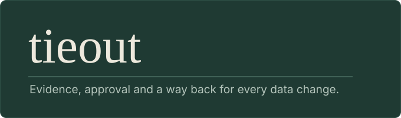

<h1 align="center">
  
</h1>

<p align="center"><a href="README.es.md">Leer en español</a></p>

**tieout is an agent skill that makes data changes safe.** When an agent edits a query, a model, a schema or a report, tieout makes it show evidence first, back up before it edits, ask a named person before it decides a business rule, and prove a tie-out with a script instead of a hunch. It works with any agent that reads [Agent Skills](https://agentskills.io) and does not depend on a particular database or BI tool.

> [!WARNING]
> Early draft, tested on synthetic data and in Claude Code only. See [Status](#status).

## What a reply looks like

Every reply that touches or analyzes an object ends with the same four lines:

```
Backup:      tieout/backups/kpi_query.sql.20261030T0915
Checked:     query parses; totals before and after: 1,204.50 and 1,171.00
Not checked: that account_type exists in the warehouse table [assumption]
Pending:     Finance lead to confirm that TEST accounts never count
```

## Install

**Claude Code**

```
claude plugin marketplace add sorenriosdev/tieout-skill
claude plugin install tieout@tieout-skill
```

**Codex**: see [docs/codex.md](docs/codex.md). **Other agents**: copy `skills/tieout/` into the agent's skills folder and ask for it by name.

The scripts need Python 3.11 or later and `pip install sqlglot duckdb` for SQL work.

## Use it

```
/tieout:tieout compare these two versions of the query; I have no database access
```

Say so if an investigation must not change anything: the skill then creates no files and answers in the reply.

## How it works

Each task starts by picking a weight and saying which:

| Weight | When | What it writes |
|---|---|---|
| **light** | One object, and the change is stated or already approved | A backup, the change, one register row |
| **decision** | A rule has two readings, or the choice belongs to someone else | One proposal with the question and the options. Nothing is changed |
| **full** | Two versions disagree, or it is a reconciliation, migration or audit | The full cycle: spec, baseline, localize, propose, approve, apply, verify, record |

The closing rule behind the banner is Δ = B − A = Σ effects + r, with the residual r inside a tolerance you agreed. A script checks it; the agent does not.

Six playbooks in `skills/tieout/playbooks/` cover tie-outs (`reconcile`), field-path tracing (`trace`), query review (`logic-review`), engine migration (`migrate-sql`), report cloning (`clone-bi`) and schema changes (`change-schema`). Rules you have approved go in `tieout/rules.local.md`; the skill applies them, and treats a rule without an approver as a question.

## Status

Thirteen synthetic scenarios, two or three runs each: average score **0.90 with tieout and 0.56 without**, at about 1.8 times the cost. It helped most where an agent would skip a step (naming a missing tool, backing up, closing with a script, asking instead of choosing a rule) and not at all on a missing-column check. The skill and the scenarios were tuned together, so read it as a first signal: [results](evals/RESULTS-2026-10-26.md).

Not yet done: any run on real Power BI, Tableau or warehouse data (those adapters are optional and were tested on hand-built files), SQL on engines other than DuckDB, a review of the hypothesis catalog by other people, other agents, and a CI run after the first one failed on Python 3.10. Details in [ROADMAP.md](ROADMAP.md). To try it on your own work: [docs/field-test.md](docs/field-test.md).

## License

[MIT](LICENSE), © 2026 sorenriosdev.
